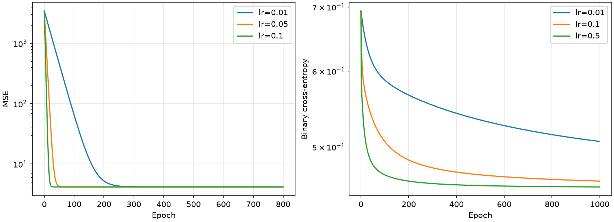

# Лабораторная №3: линейные модели

## Данные и подготовка

Для линейной регрессии использован `Student_Performance.csv`: 10 000 строк,
пять входных признаков и целевой столбец `Performance Index`. Значения
`Extracurricular Activities` преобразованы: `Yes` → 1, `No` → 0. Пропусков нет.
Разбиение выполнено через `train_test_split(test_size=0.2, random_state=42)`:
8 000 строк для обучения, 2 000 для теста. Все пять признаков стандартизированы
через `StandardScaler`, обученный только на train. Целевая переменная не
масштабировалась.

Для классификации использован `german.csv`, разделитель — `;`. В таблице
1 000 строк, 20 входных признаков и целевой столбец `Creditability`.
Пропусков нет. Распределение классов: 700 значений 1 и 300 значений 0.
Положительный класс для метрик — `Creditability=1`.
Разбиение: `test_size=0.2`, `random_state=42`, `stratify=target`.
Получено 800 обучающих и 200 тестовых строк; в тесте 140 единиц и 60 нулей.

Семь количественных признаков стандартизированы: `Duration_of_Credit_monthly`,
`Credit_Amount`, `Instalment_per_cent`, `Duration_in_Current_address`,
`Age_years`, `No_of_Credits_at_this_Bank`, `No_of_dependents`.
Остальные 13 признаков рассматриваются как категории и закодированы через
`OneHotEncoder(handle_unknown="ignore", sparse_output=False)`. Это позволяет
не задавать искусственное расстояние между кодами категорий. После подготовки
получился 61 признак. `ColumnTransformer` обучен только на train и затем
применён к test. Все четыре классификатора используют эти же матрицы и метки.

## Гипотезы и эксперименты

Обе собственные модели реализованы на NumPy. Начальные веса и смещение равны
нулю. На каждой эпохе используется вся обучающая выборка. Веса и смещение
обновляются одновременно по градиентам, рассчитанным до обновления.
`loss_history` содержит значение обучающей функции потерь после каждой эпохи;
тестовые метки в обучении не используются.

Линейная модель предсказывает `X @ weights + bias` и минимизирует MSE.
Основной запуск использует параметры контракта: `learning_rate=0.05`,
`epochs=800`. Градиент весов: `2 * X.T @ (prediction - target) / n`;
градиент смещения: `2 * mean(prediction - target)`.

Логистическая модель применяет сигмоиду к `X @ weights + bias` и минимизирует
бинарную кросс-энтропию. Параметры основного запуска: `learning_rate=0.1`,
`epochs=1000`, порог класса 1 — вероятность не меньше 0.5. Градиент весов:
`X.T @ (probability - target) / n`; градиент смещения:
`mean(probability - target)`. Сигмоида и функция потерь рассчитаны через
`np.logaddexp` для устойчивости при больших по модулю значениях. Регуляризации
в собственной модели нет.

Гипотеза эксперимента с шагом: больший шаг может ускорить снижение потерь.
При фиксированном числе эпох проверены три значения для каждой модели:

| Модель | Шаг | Эпохи | Потери до обучения | Потери после первой эпохи | Итоговые train-потери |
| --- | ---: | ---: | ---: | ---: | ---: |
| Линейная | 0.01 | 800 | 3428.035000 | 3292.539047 | 4.169736 |
| Линейная | 0.05 | 800 | 3428.035000 | 2777.910810 | 4.169736 |
| Линейная | 0.10 | 800 | 3428.035000 | 2196.175555 | 4.169736 |
| Логистическая | 0.01 | 1000 | 0.693147 | 0.689919 | 0.506652 |
| Логистическая | 0.10 | 1000 | 0.693147 | 0.663298 | 0.460628 |
| Логистическая | 0.50 | 1000 | 0.693147 | 0.596428 | 0.454203 |



У линейной модели все три шага приводят практически к одной train-MSE,
но большие шаги достигают её раньше. У логистической модели шаг 0.5 даёт
меньшие train-потери к 1000-й эпохе. Это результат для данной подготовки и
выборки; он не означает, что увеличение шага всегда полезно. Для итогового
сравнения сохранены параметры по умолчанию из контракта, без подбора по test.

В сравнении используются собственная логистическая модель и три готовые:

- `LogisticRegression(max_iter=1000, random_state=42)` с остальными параметрами
  по умолчанию, включая L2-регуляризацию и `C=1`;
- `DecisionTreeClassifier(max_depth=5, random_state=42)`;
- `KNeighborsClassifier(n_neighbors=5)` с равными весами соседей и стандартной
  евклидовой метрикой.

Контракт `BaselineComparisonResult` содержит три поля для готовых моделей,
поэтому собственная модель вычисляется отдельно и добавляется к ним в
`experiment_results.json`. Так выполнены и сравнение собственной модели из
README, и формат результата из стартового файла. Параметры дерева и KNN
фиксированы; поиск лучших гиперпараметров не проводился.

## Метрики

Тестовая MSE собственной линейной регрессии: **4.082628398521853**.
Итоговая обучающая MSE: **4.169735849525008**.

Метрики классификации на одном тесте из 200 строк:

| Модель | ROC-AUC | Accuracy | Precision | Recall | F1 |
| --- | ---: | ---: | ---: | ---: | ---: |
| Собственная логистическая | 0.837619 | 0.795000 | 0.836735 | 0.878571 | 0.857143 |
| Готовая логистическая | 0.827500 | 0.800000 | 0.837838 | 0.885714 | 0.861111 |
| Дерево решений | 0.775714 | 0.745000 | 0.763314 | 0.921429 | 0.834951 |
| KNN | 0.707738 | 0.715000 | 0.757764 | 0.871429 | 0.810631 |

ROC-AUC рассчитана по вероятностям класса 1. Остальные метрики — по бинарным
предсказаниям. Для собственной модели матрица ошибок:

| Истинный класс | Предсказан 0 | Предсказан 1 |
| --- | ---: | ---: |
| 0 | 36 | 24 |
| 1 | 17 | 123 |

Например, `Accuracy = (36 + 123) / 200 = 0.795`,
`Precision = 123 / (123 + 24)`, `Recall = 123 / (123 + 17)`.
Из-за перевеса класса 1 Accuracy нужно рассматривать вместе с другими
метриками: постоянное предсказание 1 уже дало бы 0.7 на этом тесте.
Машиночитаемые значения без округления сохранены в `experiment_results.json`.

## Выводы

Собственная линейная регрессия сошлась: её параметры совпали с решением
метода наименьших квадратов с максимальным абсолютным отклонением менее
`2e-13` на подготовленном train. Это проверка реализации; аналитическое
решение не используется в обучающей функции.

Собственная логистическая модель превосходит дерево и KNN по ROC-AUC,
Accuracy, Precision и F1 на выбранном разбиении. Дерево выигрывает по Recall
(0.921429 против 0.878571), но чаще ошибочно относит класс 0 к классу 1.
Среди четырёх моделей собственная логистическая имеет наибольшую ROC-AUC,
а готовая логистическая — наибольшие Accuracy, Precision и F1. Разница
Accuracy между логистическими моделями соответствует одному объекту из 200.

Собственная и готовая логистические модели отличаются регуляризацией и
оптимизатором: первая обучается без штрафа фиксированным числом шагов,
вторая использует L2 и готовый решатель. Это может объяснять различия
оценок, но отдельного эксперимента для установления причины не проводилось.
У дерева ступенчатые предсказания с ограниченной глубиной, а KNN зависит от
расстояний в пространстве с 61 признаком. Это возможные объяснения их
результатов, а не доказанные причины отставания.

Выводы относятся к одному фиксированному разбиению и выбранным параметрам.
Кросс-валидация и проверка статистической значимости различий не проводились.

## Воспроизводимость

Проверено на Python 3.12.13. Версии прямых зависимостей зафиксированы в
`requirements.txt`. Из каталога репозитория:

```sh
python -m pip install -r requirements.txt
python -m unittest -v test_linear_models.py
python run_experiments.py
```

Скрипт повторяет разбиения и подготовку данных, запускает модели, перезаписывает
`experiment_results.json` и `plots/training_loss.png`, выводит метрики и результаты
экспериментов с шагом. Для повторения не нужны внешние данные: оба CSV находятся
в репозитории. Стандартизация включена в скрипт экспериментов; контрактные функции
получают уже подготовленные числовые матрицы. Их веса относятся к этим матрицам.

Семь тестов проверяют один шаг каждого градиентного спуска вручную, сходимость
линейной модели к решению МНК, сходимость классификатора, устойчивость при больших
логитах, согласованность прогнозов с весами и отсутствие влияния тестовых меток
на обучение. Отдельно проверяется вычисление метрик готовых моделей на test.

Исходное задание: [AKlimovUrfu/lab3](https://github.com/AKlimovUrfu/lab3).
